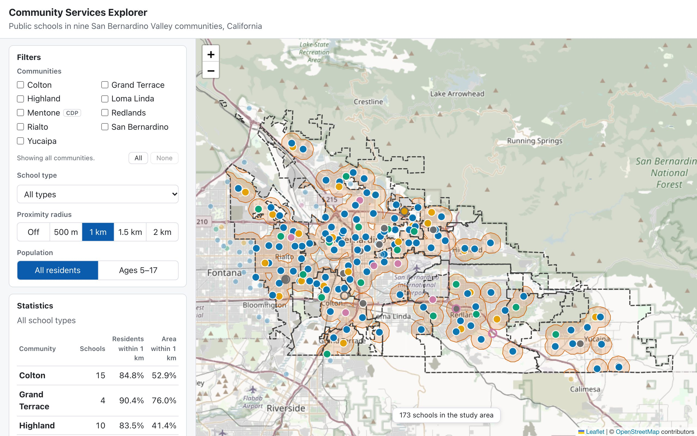
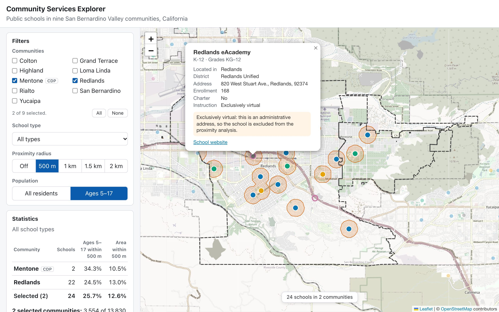
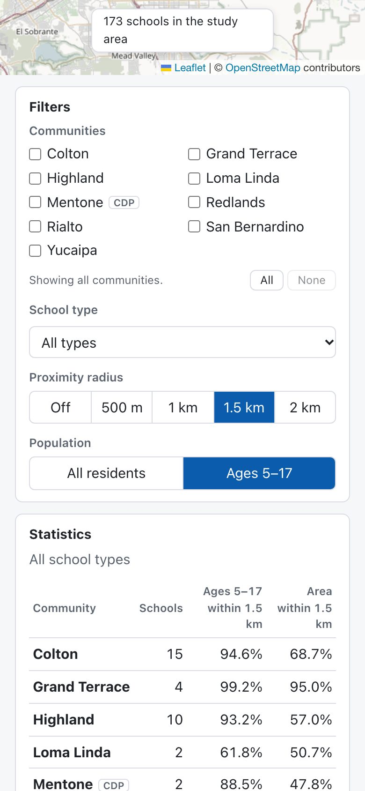

# Community Services Explorer

[](https://github.com/adtorres1987/Community-Services-Explorer/actions/workflows/ci.yml)
[](LICENSE)

A geospatial web application for exploring public schools in nine contiguous
communities of the **San Bernardino Valley, California** — Colton, Grand
Terrace, Highland, Loma Linda, Mentone, Redlands, Rialto, San Bernardino and
Yucaipa — and how many residents, and how much land, lie within a
straight-line radius of one. Built end to end, from raw public data to an
interactive map: Python data pipeline → PostGIS → FastAPI → React + Leaflet.



## Features

- Map of 173 active public schools in nine communities (612,335 residents),
  colour-coded by school type, plus 32 nearby schools that count toward coverage
- Schools assigned to communities by boundary, not by mailing address
- Filters by one or several communities and by school type; popups with district, grades, enrolment and instruction mode
- Proximity coverage at 500 m, 1 km, 1.5 km or 2 km, computed in PostGIS and drawn on the map
- Coverage by **population** — all residents or **school-age residents (5–17)** — from
  2020 census blocks apportioned by area, and by area
- Statistics for the selected communities (any combination) with a weighted total, and the method and its limits stated in the UI
- REST API returning GeoJSON, with OpenAPI docs and explicit error handling
- Reproducible data pipeline with checksummed sources, and tests at every layer

| Community | Schools | Residents within 1 km | Ages 5–17 within 1 km | Area within 1 km |
|---|---|---|---|---|
| Colton | 15 | 84.8 % | 85.5 % | 52.9 % |
| Grand Terrace | 4 | 90.4 % | 91.7 % | 76.0 % |
| Highland | 10 | 83.5 % | 86.8 % | 41.4 % |
| Loma Linda | 2 | 28.7 % | 29.9 % | 25.9 % |
| Mentone (CDP) | 2 | 68.9 % | 71.2 % | 30.1 % |
| Redlands | 22 | 74.8 % | 76.4 % | 39.6 % |
| Rialto | 28 | 94.9 % | 95.1 % | 65.7 % |
| San Bernardino | 77 | 88.3 % | 89.2 % | 58.2 % |
| Yucaipa | 13 | 59.4 % | 61.6 % | 35.3 % |
| **All nine** | **173** | **81.8 %** | **84.2 %** | **48.7 %** |

*Straight-line distance, not travel time; any public school of any type and
grade level counts. See [analysis limitations](docs/analysis-limitations.md).*

<p>
  
  
</p>

## Quick start (Docker)

Requires Docker with Compose v2 (Docker Desktop on macOS/Windows).

```bash
git clone https://github.com/adtorres1987/Community-Services-Explorer.git
cd Community-Services-Explorer
cp .env.example .env            # optionally change POSTGRES_PASSWORD
docker compose up -d --build --wait
```

Open http://localhost:8080. API docs are at http://localhost:8080/api/docs.

This starts PostGIS, loads the committed dataset (`data/processed/study_area.gpkg`),
then starts the API and the frontend (served by nginx, which also proxies `/api`).
Ports are set in `.env` (`POSTGRES_PORT`, default 5434; `APP_PORT`, default 8080).
Stop with `docker compose down`; add `-v` to delete the database volume.

## Local development

Requires Python 3.14 and Node.js 24+ (the versions CI uses).

```bash
# Python environment
python3.14 -m venv .venv
source .venv/bin/activate
pip install -r requirements.txt

# Database only, then load the data
cp .env.example .env
docker compose up -d --wait db
python scripts/load_postgis.py

# API on http://localhost:8010 (docs at /docs)
uvicorn app.main:app --app-dir backend --port 8010 --reload

# Frontend on http://localhost:5174 (in another terminal)
cd frontend
npm install
npm run dev
```

### Rebuilding the data from the original sources

```bash
python scripts/download_data.py       # CDE schools + Census boundaries and population (~1.2 GB), checksum-verified
python scripts/prepare_study_area.py  # assign by boundary, add population → data/processed/study_area.gpkg
python scripts/load_postgis.py
```

The study communities are listed by Census GEOID in `STUDY_PLACES` in
`scripts/prepare_study_area.py`.

Most of the download is the 2020 DHC file (1.06 GB), the only bulk source of
ages by census block; the app itself only needs the committed ~3 MB GeoPackage.

If your database was created before migration `002` or `003`, either recreate it
(`docker compose down -v`) or apply the missing files in `database/migrations/`
with `psql`, then reload (see [docs/database.md](docs/database.md)).
Until then the "Ages 5–17" option is disabled.

## Tests

```bash
python -m pytest                   # data pipeline + API (needs the loaded database)
cd frontend && npm test            # components, helpers, API client
```

CI runs both suites plus a Docker Compose smoke test on every push.

## Architecture

```text
CDE + Census data → Python/GeoPandas pipeline → PostGIS → FastAPI → React + Leaflet
```

All analysis runs in **EPSG:26911** (NAD83 / UTM zone 11N, metres) inside
PostGIS; the API returns GeoJSON in EPSG:4326. Details and design decisions are
in [docs/architecture.md](docs/architecture.md).

| Layer | Technology |
|---|---|
| Data processing | Python 3.14, GeoPandas, Shapely, Pyogrio, PyProj; QGIS for visual validation |
| Database | PostgreSQL 17 + PostGIS 3.5 |
| API | FastAPI, Pydantic, psycopg 3 |
| Frontend | React 19, TypeScript, Vite, Leaflet / React-Leaflet |
| Testing | pytest, Vitest, Testing Library |
| Runtime / CI | Docker Compose, nginx, GitHub Actions |

```text
backend/        FastAPI app (api/, schemas/, services/) and API tests
frontend/       React app (components/, features/, maps/, services/)
scripts/        download_data.py, prepare_study_area.py, load_postgis.py
database/       migrations/ and documented spatial queries (sql/)
data/           raw/ (downloaded, not committed) and processed/ (committed)
tests/          data pipeline tests
docs/           architecture, data sources, database, API, limitations
```

## Data sources

| Dataset | Publisher | Terms |
|---|---|---|
| [California Public Schools 2025–26](https://data.ca.gov/@california-department-of-education/california-public-schools-2025-26) | California Department of Education | No restrictions on public use |
| [TIGER/Line 2026 Places, California](https://www2.census.gov/geo/tiger/TIGER2026/PLACE/) | U.S. Census Bureau | Public domain |
| [TIGER/Line 2020 blocks](https://www2.census.gov/geo/tiger/TIGER2020PL/LAYER/TABBLOCK/2020/), [2020 P.L. 94-171 population](https://www2.census.gov/programs-surveys/decennial/2020/data/01-Redistricting_File--PL_94-171/California/) and [2020 DHC ages](https://www2.census.gov/programs-surveys/decennial/2020/data/demographic-and-housing-characteristics-file/California/) | U.S. Census Bureau | Public domain |
| Basemap tiles | © [OpenStreetMap](https://www.openstreetmap.org/copyright) contributors | ODbL; [tile usage policy](https://operations.osmfoundation.org/policies/tiles/) |

Field descriptions, checksums and processing criteria: [docs/data-sources.md](docs/data-sources.md).

## Documentation

- [Architecture and design decisions](docs/architecture.md)
- [Data sources and processing](docs/data-sources.md)
- [Database model and spatial queries](docs/database.md)
- [API reference](docs/api.md)
- [Analysis limitations](docs/analysis-limitations.md)
- [Development environment](docs/environment.md)
- [Data folder](data/README.md) and [frontend](frontend/README.md) notes
- [Project plan and status (Spanish)](community-services-explorer-roadmap.md)

## Next steps

- More community services: parks, libraries, clinics, transit (the `facilities` table is already generic)
- Network-based accessibility: walking distance and service areas on the street network
- OGC services (WMS/WFS, OGC API Features) and an ArcGIS Maps SDK comparison

## License

Code is released under the [MIT License](LICENSE). Data remains under the terms of its publishers.
